# Using the Snowpack Agent Lab in your web browser

**Research and decision support only. Nothing in the lab is an avalanche forecast or a danger rating**, and every
page says so. The lab is a local benchmark: computer "agents" try to predict the snow pit observed at Bow Summit,
Goat's Eye and Simpson from the data available beforehand, and are scored against pits they were not shown.
SNOWPACK, as the site runs it, is the agent to beat (the "incumbent").

This guide is for running the whole lab from a web browser on your Mac: setting up the data, running competitions,
training agents overnight, watching them in the Arena, and checking whether a trained agent really does better.
You type one command in Terminal to start the app; everything else is buttons in the browser, including keeping
the app itself up to date. Long jobs keep running on their own when you close the browser. The first page,
**Overview**, always says what to do next, and the top of every page shows what is running.

Contents

1. [First-time setup](#1-first-time-setup)
2. [Starting the app](#2-starting-the-app) (and [updating it](#21-updating-the-app))
3. [A tour of the pages](#3-a-tour-of-the-pages)
4. [Running the lab from the browser, step by step](#4-running-the-lab-from-the-browser-step-by-step)
5. [The Arena: watching competitions and training](#5-the-arena-watching-competitions-and-training)
6. [Reading the results](#6-reading-the-results)
7. [Stopping and resuming](#7-stopping-and-resuming)
8. [Keeping the Mac awake overnight](#8-keeping-the-mac-awake-overnight)
9. [Where results are stored](#9-where-results-are-stored)
10. [Viewing from another device](#10-viewing-from-another-device)
11. [Troubleshooting](#11-troubleshooting)

## 1. First-time setup

You do this once. The installation needs Terminal; after it you will not need Terminal except to start the app.

1. Install the tools: follow [`run_locally.md`, section 0](run_locally.md#0-one-time-tools-about-10-minutes-mostly-downloads).
   A new Mac has no Homebrew (`zsh: command not found: brew`), so that section installs Homebrew first, puts it on
   your PATH and checks it with `brew --version` before `brew install python@3.12 cmake`. Do not skip it.
2. Follow steps 1 to 3 of [`run_locally.md`](run_locally.md#the-commands): clone the project, create the Python
   environment and the SNOWPACK engine (`bash scripts/setup_env.sh` does both).
3. That is all. Steps 4 to 9 of `run_locally.md` (prepare the data, build cases, train, check) can now be done from
   the browser, as below.

## 2. Starting the app

Open Terminal and type:

```bash
cd banff-snowpack                 # the folder you cloned
source .venv/bin/activate         # every time you open a new Terminal window
snowagent lab app
```

It prints the address and opens it in your browser:

```
Snowpack Agent Lab: http://localhost:8501  [Research and decision-support product only. ...]
data: /Users/you/banff-snowpack/data/lab
Ctrl-C stops the app; background jobs keep running (see the Jobs page).
```

If the browser does not open by itself, open **http://localhost:8501**. Leave the Terminal window open while you
use the app. To stop the app, click in that Terminal window and press **Ctrl-C**. Stopping the app does not stop
work you started from it (see [Stopping and resuming](#7-stopping-and-resuming)).

Options, if you need them: `--port 8502` (another port, for example if 8501 is in use), `--data-root <folder>`
(another lab data folder), `--no-open` (do not open the browser), `--host 0.0.0.0` (see
[Viewing from another device](#10-viewing-from-another-device)), `--no-update-check` (never ask GitHub for a
newer version). The app works from any folder, but the `source .venv/bin/activate` line must have been run in
that Terminal window.

### 2.1 Updating the app

The app asks GitHub for a newer version by itself (when you open a page, at most once every 15 minutes; or press
**Check for a newer version** under the menu). When there is one, a blue notice at the top of every page
says **A newer version of the app is ready**, lists what is new, and offers one button: **Update and restart**.

- Press it. The app fetches the new version (under a minute; about 5 minutes when the new version also rebuilds
  the SNOWPACK engine, which the notice says), then restarts by itself. The page says "The app is restarting" and
  comes back on its own a few seconds later, on the page you were on. You do not touch Terminal.
- **While something is running** (a training run, a competition, a set-up) the button is greyed out, so that no
  run gets new code half way. The notice stays, and the button works once the run has ended or been stopped.
- If you update from Terminal instead (`git pull`), the app notices that its files changed and shows **Restart
  the app**. One press does the rest.
- Nothing in the lab's data, runs or scores is touched by an update.

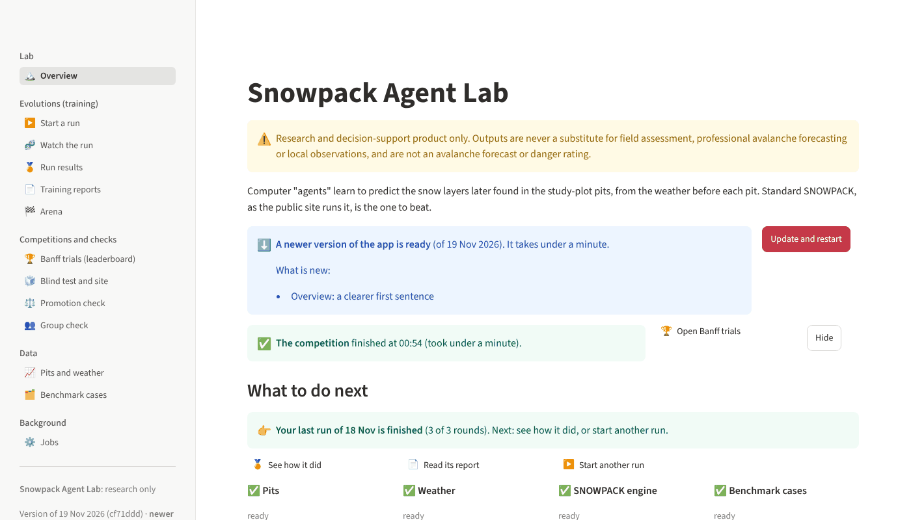

The version in use is shown under the menu ("Version of 19 Nov 2026 · up to date"). If a copy of the project has
changes of its own, the app says so and leaves updating to Terminal.

The very first time, to get the version that has this button, update the old way once: press **Ctrl-C** in the
Terminal window that runs the app, type `git pull`, then start the app again with `snowagent lab app`.

## 3. A tour of the pages

The page menu is in the left sidebar, in the order you work: set up, start a run, watch it, see how it did, then
what to do with its best agent. Every page shows the research and decision-support label once, under its title,
and one sentence on what the page is for.

**The top of every page** shows what is running now: its name in plain words, the step it is on (or, for a
training run, the round, the time left and when it should finish) and a progress bar. It updates itself every few
seconds, so there is nothing to refresh. What ended lately stays there too: a finished job for an hour, a failed
or stopped one for a day, or until you press **Hide**. Each line has a link to the page it belongs to.

**The Overview** opens with **What to do next**: one sentence that follows the state of the lab (set up the data,
build the cases, build the engine, start a run, watch the run that is going, resume a stopped run, or see how the
last one did) with a link to the page.

| Menu group › page | What it is for | What to look at |
|---|---|---|
| Lab › **Overview** | The first page: what to do next, what is ready, the best agent so far | **What to do next**; four ticks (pits, weather, SNOWPACK engine, benchmark cases); **Build the SNOWPACK engine** when it is missing or out of date; the best agent; **Set up data** (first use); the names used in the lab; data coverage per site folded underneath |
| Evolutions (training) › **Start a run** | Start a training run | 1. the Parker Ridge check (set up once); 2. the **Kind of run** and **Start training**. Rarely needed options are under **Advanced** |
| Evolutions (training) › **Watch the run** | How a run is going, or how an old one went | A line that says whether this run is going now or when it ended; state, round, best score, time left; **Stop the run** or **Resume the run**; after each round the score on the locked test winters against standard SNOWPACK |
| Evolutions (training) › **Run results** | The agents of a run, best first | The round's table; the **Agent card** (what the agent changed, in plain words); links to its report, the blind test and the promotion check |
| Evolutions (training) › **How agents change** | What training changes in the agents' settings, round by round, live or finished | what the run may change and the score weights it uses; how far the best agent has moved from the standard settings (a heat map, blue raised, red lowered); one setting across every agent of every round; one agent's settings and family tree. **Add a run trained on another computer** takes a cloud run's .tar.gz |
| Evolutions (training) › **Training reports** | A plain-language report of a training run, to read or download | pick the run; the report appears, then **Download (HTML)** (opens in a browser or Word; print it to save a PDF) |
| Evolutions (training) › **Arena** | Watching runs as they happen, replays | The race, the heat strip, the duel and (training) the family tree |
| Competitions and checks › **Banff trials (leaderboard)** | Competitions: every chosen model on every case; where a model change is tried against standard SNOWPACK | **Run a competition**; the leaderboard table; a case's predicted profile beside the observed pit |
| Competitions and checks › **Blind test and site** | What to do with an agent you believe in | 1. choose the agent; 2. freeze it for this winter's live blind test; 3. show it on the public site as an experimental extra |
| Competitions and checks › **Promotion check** | The fair test of an evolved agent, many hours | **1. Estimate the time**, **2. Start the check**, the verdict |
| Competitions and checks › **Winter-by-winter test** | How a kind of training does on winters it never saw, winter by winter, with the average and the spread; about 1 hour for the quick test | choose what to test and how thorough; **1. Estimate the time**, **2. Start the test**; the summary in sentences and the table of winters |
| Competitions and checks › **Group check** | The agents pooled as a group on winters none trained on: four answers and advice | **Run a new group check** › **Start the group check**; the answers appear when it is done |
| Competitions and checks › **Stability check** | Whether SNOWPACK's stability numbers (SK38, crack length, RTA), and the weak-layer signs in any model's own layers (Carver Daniels too), point at the layers that broke in the pits' tests | **Run a new stability check** › **Start the stability check**; the answers appear when it is done |
| Data › **Pits and weather** | Look at one snow pit or the station weather | The profile plot (grain forms by colour, hardness by width) and the weather charts |
| Data › **Benchmark cases** | The cases agents are tested on | Case counts per site and type; what an agent "sees" for one case; the leakage checks (all must pass). Sidebar: **Build cases** |
| Background › **Jobs** | Everything the app has run in the background; rarely needed | Come here when something failed: the job's steps, its log, Stop and Resume |

**The names.** The lab's evolutions (the lines of models that training evolves) have plain names, and its
competitions (the tests the models meet) are named after field units. They are labels only; no score depends on
them.

| Name | What it is | Where in the app |
|---|---|---|
| **Tuned SNOWPACK** | SNOWPACK with evolved settings | Start a run (the kinds of run that start with "Tuned SNOWPACK:"); every run's label |
| **Column model** | The lab's own model, with no SNOWPACK | Start a run ("Column model, no SNOWPACK") |
| **Process switches** | The column model with whole processes switched on or off (ADR-120) | Start a run ("Process switches, no SNOWPACK") |
| **Layer life stories** | Each layer's form decided from its whole history (ADR-120) | Start a run ("Layer life stories, no SNOWPACK") |
| **Weather recipes** | Layers made from weather patterns, with no heat physics (ADR-120) | Start a run ("Weather recipes, no SNOWPACK") |
| **Column + site traits** | The lab's own model steered by a scorecard of fixed site traits (ADR-122) | Start a run ("Column + site traits, no SNOWPACK"), with the Parker Ridge check ticked |
| **Banff** | The model-change trials | Banff trials (leaderboard) |
| **Jasper** | The Parker Ridge check | Start a run (part 1) and Watch the run |
| **Lake Louise, Yoho and Kootenay** | The live blind test | Blind test and site (part 2) |
| **Mount Revelstoke and Glacier** | The forecaster rules trial | Not in the app yet |

**Full and trimmed kinds of run (ADR-123).** Each of the five evolutions built on the lab's own model has two kinds
of run on the Start a run page: the full one ("..., no SNOWPACK"), where evolution may change every setting, and a
trimmed one ("..., trimmed"), where it changes only the twelve or fewer settings that moved the score most in a
sensitivity screen on the training winters. The other settings stay fixed at their starting values. Fewer settings
leave less room to fit the training pits by chance. Run both with the same rounds and population and compare them
on the locked winters and the Parker Ridge check; a trimmed run's label says "trimmed".

**Your own names for the evolutions.** You can call the evolutions what you like, for example after colleagues,
without those names ever leaving your computer:

1. Open **Overview** and unfold **The names used in this lab**.
2. Under **Your own names for the evolutions**, type a name in the box of each evolution you want to rename. Leave
   a box empty to keep the plain name.
3. Press **Save my names**. The new names show at once on Start a run and in every run's label.

They are kept in one small file, `names.json`, in the lab's data folder on your computer (`data/lab/`). Git never
looks in that folder, so the names are not sent to GitHub and do not appear on the public site. A new computer
starts with the plain names; type yours in again there. Do not put personal names in the app's code or its guide.

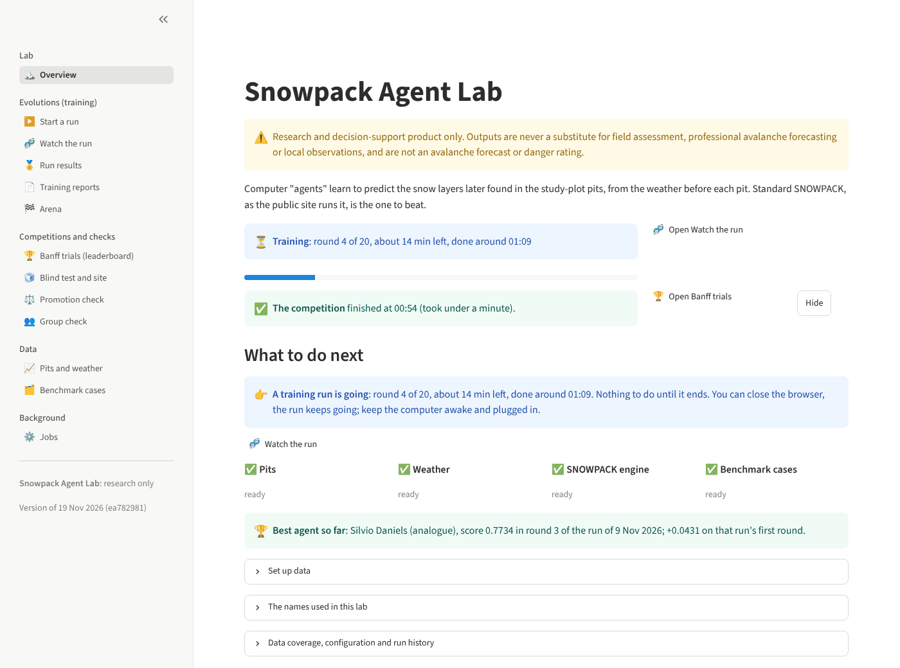

## 4. Running the lab from the browser, step by step

Do these in order the first time; the Overview's **What to do next** names the step you are at. Each step that
takes more than a few seconds runs as a **background job**. While it runs, the top of every page says so, with its
step and how long it has taken; the page that started it also shows its steps as a checklist (done, running,
failed) with **Stop** and **Resume** buttons, and its log folded under **Technical details**. All of this updates
itself. The app refuses to start a second job of the same kind while one is running, so a double click cannot
start two trainings.

### 4.1 Set up data (Overview page, once, about 5 minutes)

Open **Overview**, then **Set up data**. The table shows what exists: station files, observed profiles, ERA5 months
(for example "0 of 241") and the lab tables. Below it is the worst-case time estimate. Leave **Fetch ERA5 months** ticked:
ERA5 fills gaps in the station weather (wind, radiation, pressure, precipitation) as the published runs do, and
without it the scores differ. **ERA5 downloads at once**: 4 to 6 is fine on home internet.

Press **Run set-up**. It runs three steps in order and shows each one's state:

1. **getting the station files, pits and weather** (prepare): restores the station files, builds the observed profiles, and copies the ERA5 months from the
   repository's ready-made download (branch `claude/lab-era5-box`, about 0.2 GB, ADR-079). Only months that download
   lacks come from the ERA5 mirror, at about 5 to 7 minutes each (2 minutes in all on a fast connection, checked
   on a fresh clone on 2026-10-06);
2. **making the lab's tables** (init): creates the lab's folders;
3. **loading the pits and weather** (import): reads the profiles and weather into the lab's tables (about 1 minute).

Nothing that exists is overwritten. If it stops (sleep, Wi-Fi, a month the ERA5 mirror has not published yet),
press **Resume** or **Run set-up** again: finished months are kept. Three or so `FAILED FileNotFoundError` lines for the newest
months (for example 2026-06, 2026-09, 2026-10) are normal: the mirror has not published them yet.

**The SNOWPACK engine.** If the Overview's SNOWPACK engine tick is missing ("not built yet", or "needs a rebuild"
after an update that changed the engine), press **Build the SNOWPACK engine** in the box under the ticks. It takes
about 5 minutes and shows at the top of every page like any other job. It is the same as
`bash scripts/build_snowpack.sh` in Terminal.

### 4.2 Build cases (Data › Benchmark cases, about 5 minutes)

On **Benchmark cases**, open **Build cases** in the sidebar and press **Build**. It builds one case per usable pit
(two types: `forecast_h72`, a 72-hour forecast of the next pit, and `next_pit`), about 340 cases, and checks every
case for leakage (an agent must never see the pit it predicts). The job shows on the page and at the top of every
page; when it is finished the page shows the cases.

### 4.3 Run a competition (Competitions and checks › Banff trials, minutes)

A competition runs every chosen agent on every case and scores it. Open **Banff trials (leaderboard)**, then **Run
a competition**:

- **Agents**: the default agent of each of the five families (persistence, weather_rule, analogue, snowpack,
  hybrid). Keep all.
- **Trained agents**: optional, the top two agents of each training run's last round, newest run first, by the names
  the Run results page gives them. To compare a run's best agent with SNOWPACK with snow depth sensors, choose it here
  and pick `snowpack` and `snowpack-snow-depth` under Agents. On the Leaderboard, set **Winters** in the sidebar to
  the run's locked test winters (2023-24 to 2025-26 by default): the agent learned from the others.
- **Plots**, **Case types**: keep all for a full competition.
- **Case set**: `all`.
- **Workers**: how many cases run at the same time. Use the number of performance cores of your Mac (Terminal:
  `sysctl -n hw.perflevel0.physicalcpu`), for example 8.
- **Engine**: `auto` uses the SNOWPACK engine; `none` skips it (a quick try; SNOWPACK's agent is then "skipped").
- **Cases**: `20 (quick try)`, `100`, or `All cases`.
- **Seed**: leave 0.

Press **Start competition**. With the engine, the full set takes about 20 minutes with 4 workers. Watch it in the
**Arena**, and read the result on the **Leaderboard** when it is finished.

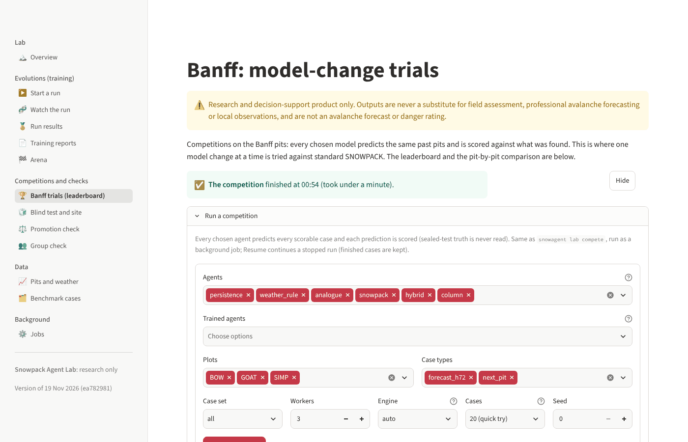

### 4.4 Start training (Evolutions › Start a run, overnight)

Training is evolution: round 1 scores the starting agents on every case; each later round keeps the best two
unchanged ("survivors") and makes new agents from them by small random changes ("mutation") or by mixing two of
them ("crossover"). Open **Start a run**. The page has two parts.

**1. Jasper: the Parker Ridge check (optional, set up once).** Press **Set up Parker Ridge check** once (5 to 10
minutes; its progress shows just below the button and at the top of every page). After that, every new run can
also score its agents each round on the Parker Ridge pits, a plot outside Banff that the agents never train on.
A run can start without it. Press **Update Parker Ridge check** after new Jasper pits arrive.

**2. The run.** Pick a **Kind of run**. Each carries the name of its evolution (your own name for it, if you
gave it one):

- **Tuned SNOWPACK: Overnight (about 8 hours, resume on later nights)**: Rounds 20, Population 10, Survivors 2, Screen
  cases 30, every plot and case type. The first full run on an Apple-silicon Mac with 8 workers (2026-10-06) took
  8 hours for all 20 rounds, about 25 minutes a round; if a night is not enough, press **Resume the run** the next
  evening to continue the same run. The run's report (Training reports) gives the measured times of your own runs.
- **Tuned SNOWPACK: Quick check (about 20 minutes, one plot)**: Rounds 2, Population 4, Simpson only, next-pit cases
  only. Use it to see that everything works.
- **Column model, no SNOWPACK**: evolves only the lab's own snowpack model (Rounds 30, Population 20).
- **Custom**: the configuration's defaults, to set by hand.

**Workers** (cases at the same time) starts at your Mac's performance-core count. The other options are under
**Advanced** and rarely need changing:

| Option | What it means | Default |
|---|---|---|
| Mutation strength | The chance that each gene changes in a new agent, and how far (0 to 1) | 0.2 |
| Crossover share | Share of new agents made by mixing the two survivors | 0.25 |
| Seed | Makes a run repeatable; change it for an independent second run | 0 |
| Engine | `auto` uses SNOWPACK (needed for real training); `none` skips it | auto |
| Plots, Case types | Which cases to train on | from the kind of run |
| Initial population | Families in round 1 | all five |
| Screen cases | A new agent with changed SNOWPACK settings is first tried on this many cases, and only runs on all of them if it beats the weaker survivor there; saves hours | 30 (0 = off) |
| Family slots | Each round also gives every family one new agent, so the other families keep improving too | off |
| Locked test winters | The most recent winters are kept out of training entirely: no agent is trained or chosen on them, and after each round the leaders are tested on them. See below | 3 (0 = off) |

**Locked test winters.** With the default 3, a run trains on 1997-98 to 2022-23 and never sees 2023-24 to 2025-26
(not even as analogues). After each round's winners are chosen, they are scored on those locked winters, so the
Watch the run page shows a true score on winters the agents never saw, beside standard SNOWPACK's. If the evolved agent
does no better there, its gains came from fitting the training winters. The promotion check is still the final
word: it re-trains with each winter hidden in turn. A selection with fewer than 5 winters (for example the Quick
check on one plot) locks nothing.

Press **Start training**. The page confirms it and links to **Watch the run**; about a minute later, once the run
has loaded its cases, it shows at the top of every page. Only one training runs at a time: while one runs, the
page says so, offers **Stop the run**, and greys out Start.
The run keeps going if you close the browser or stop the app; keep the Mac awake ([section 8](#8-keeping-the-mac-awake-overnight)).

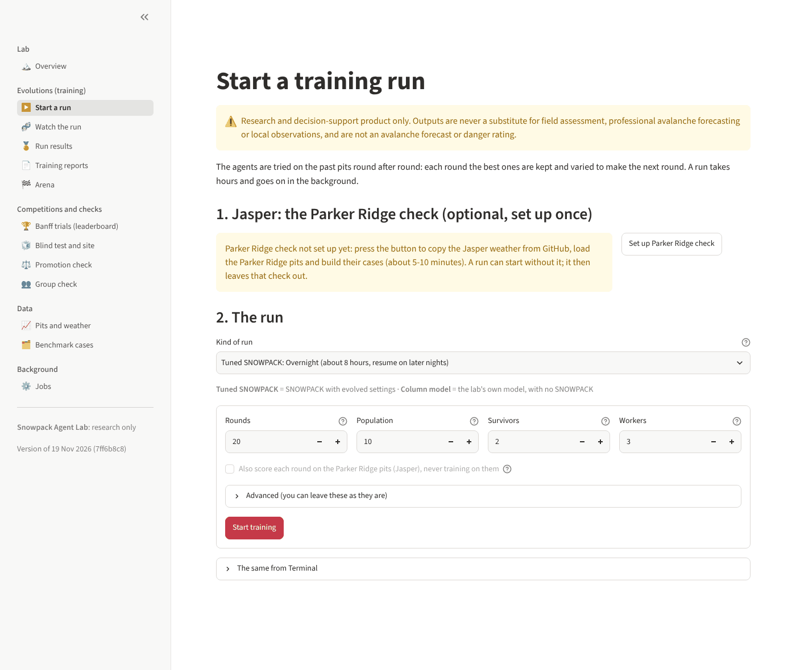

### 4.5 Watch progress (Evolutions › Watch the run, then Run results)

**Watch the run** opens on the run that is going now, otherwise on the one you last looked at, otherwise the
newest; pick another under **Training run** at the top of the page (each run is listed by its start time, its
evolution, its rounds, its state and its best agent). The first line says which case you are looking at:

- **This run is going now.** Below it: the state, the round, the best score so far and how much it rose since
  round 1, the **time left** with the clock time it should finish, a progress bar of cases, and **Stop the run**.
  The panel updates itself every 5 seconds, and the whole page redraws when a round finishes.
- **This run is over. It finished at 03:12 on 25 Oct, after 15 of 15 rounds. Nothing is running here now.** An
  old run is never shown as if it were the one you just started.
- **This run is not going now** (stopped, cut short by sleep or a restart, or failed), with **Resume the run**.

After each round the page shows, in this order:

- **Locked test winters**: one line that says whether the round's best agent, by name, beats standard SNOWPACK
  on the winters the agents never saw, then the chart of that score per round against SNOWPACK's dashed line. This
  is the number to watch.
- **Jasper: the Parker Ridge check** (if the run was started with it): the same for the Parker Ridge pits.
- **More charts**, folded: the best score on the training winters per round (it should rise, then flatten), and
  the *train vs held-out gap* (the "memorising gap": the score on the other seasons minus the score on one recent
  season). A gap that keeps widening (a "flag" marker) means the agents may be memorising the training seasons. It
  is a warning sign only, never proof either way: only the promotion check below is evidence.
- **Technical details**, folded: the run's settings, its files and its log.

**Run results** lists the agents of a round, best first, and the **Agent card**: pick any agent to see, in plain
words, how its settings differ from its family's default (for example "Simpson precipitation ×1.12") and, folded,
its ancestry back to round 1. The links under the card go to the run's report, to **Blind test and site** (which
opens on the agent you chose) and to the **Promotion check**.

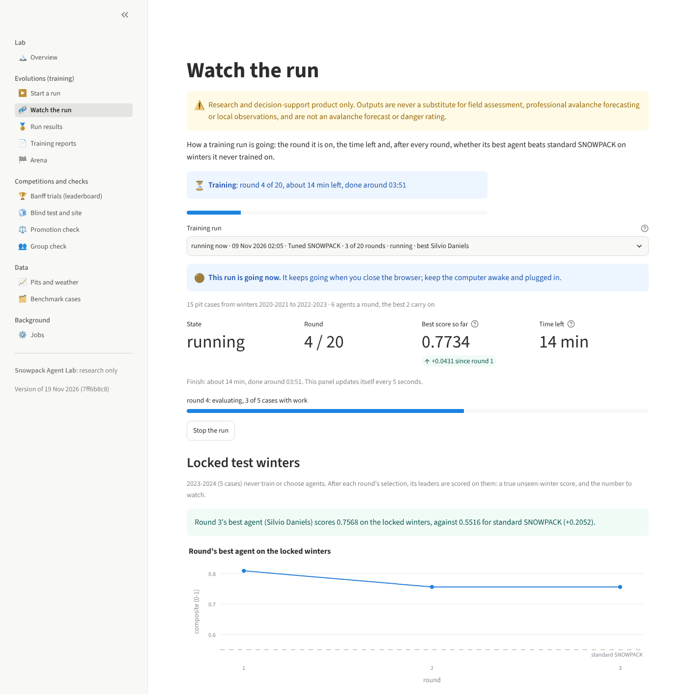

**How agents change** shows the run's agents as settings ("genes"). It opens on the run that is going. At the top:
what kind of model the run evolves, how many settings each agent carries and how many the run may change, and the
score weights it ranks agents with beside today's (training never changes them). Then:
- **How far the best agent has moved from the standard settings**: one line for the total distance, and a heat map
  with one row per setting the best agent has moved. Blue is raised, red is lowered, grey is the standard value;
  hover a square for the amount as a share of the setting's allowed range.
- **One setting, round by round**: pick a setting (the most moved come first) to see every agent's value as grey
  dots and the round's best agent as a blue line. Dots bunching together mean the run has settled on a value.
- **One agent**: its settings beside the standard ones, with what each does, and where it came from: its parents,
  grandparents and so on inside the run, each step saying how it was made (a small random change, or a mix of two
  good agents) and what it changed.

While a run is going the round being tested shows up before it is scored, and the page redraws itself when a round
starts or finishes. To look at a run trained in the cloud, open **Add a run trained on another computer**, choose its
`.tar.gz` file (the one without `-cache` in its name) and press **Add this run**.

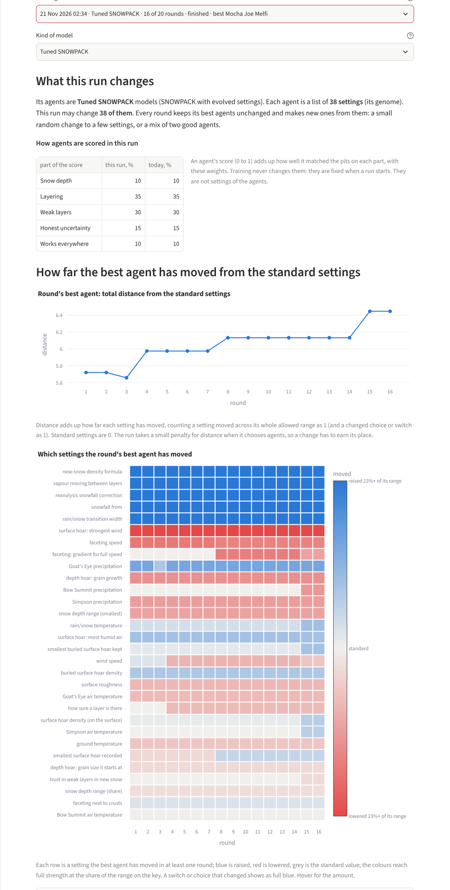

The **Arena** shows the same run live ([section 5](#5-the-arena-watching-competitions-and-training)).

### 4.6 The promotion check (Competitions and checks › Promotion check, many hours)

The promotion check asks the only question that matters: does the trained agent beat SNOWPACK on seasons it
never trained on? It repeats the whole training once per season, each time with that season held out, and
compares the winner of each repetition with SNOWPACK on the held-out season (leave one season out).

On **Promotion check**, choose the training run at the top of the page, then open **Start or resume a promotion
check**:

- **Round** and **Rank**: which agent to check; the last round and rank 1 (its best agent) are filled in.
- **Workers**, **Engine**: as for training (Engine `auto`).
- **Rounds per fold**, **Population**: 0 means the same as the training run (the full check). Fewer is cheaper
  but a weaker test, and the result says so.
- **Held-out seasons**: all of them for a verdict. Removing some lets you split the check over several nights
  (the verdict needs all of them).
- **Check id**: the name of the check. The same id resumes it.

Press **1. Estimate the time** first. After a few seconds the estimate appears by itself (the full check
of an overnight run is about 12 to 24 hours with 8 workers). Then press **2. Start the check** (it stays greyed
out until an estimate of exactly these options has finished). If it stops, choose it under **Resume a check** and
press **Resume check**; finished seasons are kept.

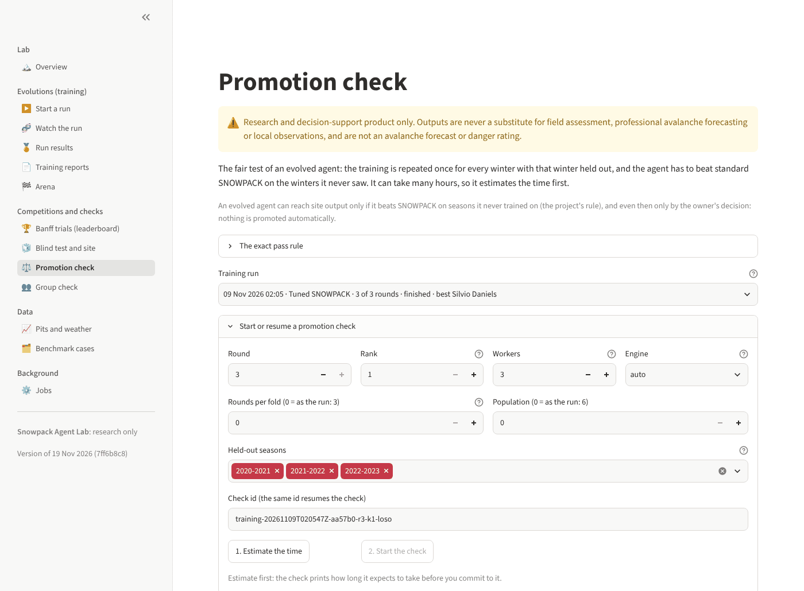

### 4.7 The winter-by-winter test (Competitions and checks › Winter-by-winter test, about 1 hour for the quick test)

The promotion check tests one agent. The winter-by-winter test asks the question before that: does this kind of
training learn something that holds on a winter it has never seen? It deals the winters out into five groups (the
1st, 6th, 11th... winter in one group, the 2nd, 7th, 12th... in the next, so every group has old and recent
winters), trains with one group held out, forecasts the held-out winters, and repeats until every winter has been
held out once (ADR-125). The three locked test winters are left out of everything, so they stay a clean final
test. Parker Ridge is not part of it either.

Each held-out winter gets three scores out of 100: the trained agent, the same model before any training (the
difference is what training added) and standard SNOWPACK (the bar to beat). Under **Results** the page says in
sentences:

- the score of each of the three over all the held-out pits;
- against SNOWPACK: the average difference a winter, how much a typical winter differs from that average, the
  worst and the best winter, in how many winters the trained agent was better and worse, and the range the true
  average is likely in (90%, from drawing the winters again and again);
- what training added, and whether that holds on new winters (it does when the whole likely range is above zero);
- memorising: what training added on the winters it trained on, next to what it added on the winters it had not
  seen. A gap of more than half a point was learned by heart from those winters, not learned about snow;
- how long the computing took, and each training round.

Below that, a table with one row a winter (pits, the three scores, the two differences) and a chart of trained
minus SNOWPACK for each winter. A winter with fewer than 5 pits has a rough score of its own; the page says how
many there are.

To start a test, open **Start or resume a test**:

- **What to test**: one of the column-model evolutions (fast), or tuned SNOWPACK (slow: SNOWPACK runs in every
  round, so the test takes days). It tests the full kind of run, where evolution may change every setting; the
  trimmed kinds of run (ADR-123) cannot be tested this way yet.
- **How thorough**: Quick (5 groups, 6 rounds of 10 agents, about 1 hour on the Mac with 8 workers), Full
  training, overnight (5 groups, 30 rounds of 20 agents, 5 to 7 hours) or Every winter on its own (each of the 25
  winters held out alone, 6 rounds of 10 agents, 4 to 5 hours and 9 GB of disk; it can be stopped and resumed).
  The times are for the column model and come from the Mac's first test (Quick, 19 November 2026: 49 minutes of
  computing and 4 minutes to prepare the cases); the page's own estimate is the one to go by. A test of 6 rounds
  tests a 6-round training: it says what that short training does. Full training trains as long as a full
  training run of the column model, so it says what a real run does on winters it has not seen.
- **Workers**, **Engine**: as for training (Engine `auto`, so standard SNOWPACK can be scored as the bar).
- **Test name**: filled in for you; the same name resumes the test, and finished groups are kept.

Press **1. Estimate the time**: after some seconds the page says how long the test should take on this computer,
how long each group takes, and how much disk the groups' cases need (each group needs its own copy of the cases,
about 0.35 GB). The estimate uses speeds measured on this computer. If the computer has never run this kind of
agent, or only in a much smaller run, it first times it on a few dozen pits (about ten seconds; nothing of that
is kept) and the sentence says so. Where a speed could not be measured, the sentence says that the estimate is
a rough guess from another machine's speed. (The Mac's first estimate, 3 h 18 min for a test that took 53
minutes, was such a guess and did not say so; ADR-126.) If a training run is going when you press the button,
nothing is timed beside it, because the busy computer would make the answer too long: the sentence says so, and
the estimate you ask for after the run has ended is measured. Then press **2. Start the test**. It cannot start while
a training run or another test is going: the two would share the computer's cores. While it runs, the bar at
the top of every page says which part it is on and about when it will be done. An interrupted test is listed
under **Resume a test**. The same from Terminal: `snowagent lab winter-test --initial column --workers 8`.

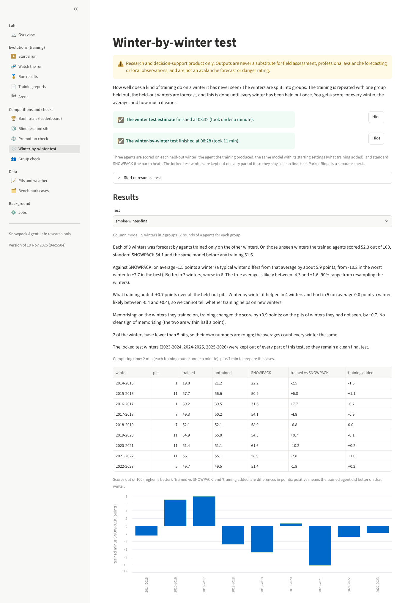

The picture shows a small trial run in the cloud (one plot, 9 winters in 2 groups, 2 rounds of 4 agents): it
shows what the page looks like, not a result to rely on.

## 5. The Arena: watching competitions and training

The **Arena** shows a competition or a training run while it runs (it updates itself every 2 seconds) and replays
finished runs. Choose the run in the sidebar; a run in progress is marked "live" and listed first. For a finished
run, drag the **Replay position** slider, or press **Play** in the sidebar to watch it again from the start.

- **Race**: each agent's average score over the cases scored so far, best on top, coloured by family. The dashed
  line is SNOWPACK, the bar to beat (in later training rounds, SNOWPACK's round-1 score on the same cases). This is
  the average case score; the leaderboard's composite also weighs robustness (bad failures), so the final ranking
  is on the Banff trials and Run results pages.
- **Heat strip**: one row per agent, one column per case, darker = better. Hover over a square for the site, case
  type, season, pit date and the four part scores.
- **Duel**: the latest case's observed pit beside the predicted profile of the current leader and of SNOWPACK.
- **Evolution** (training): the family tree. Each dot is an agent, by round (left to right) and rank (top = best),
  bigger = better score. Lines show where each agent came from: solid = mutation, dashed = crossover, dotted =
  kept unchanged. Ringed agents survive into the next round; faded ones were screened out. Hover for the changed
  genes. Below it: the best score per round and the memorising gap.

Every number on the page comes from the run's own files. Runs from before the Arena existed are replayed from their
files (the page says so).

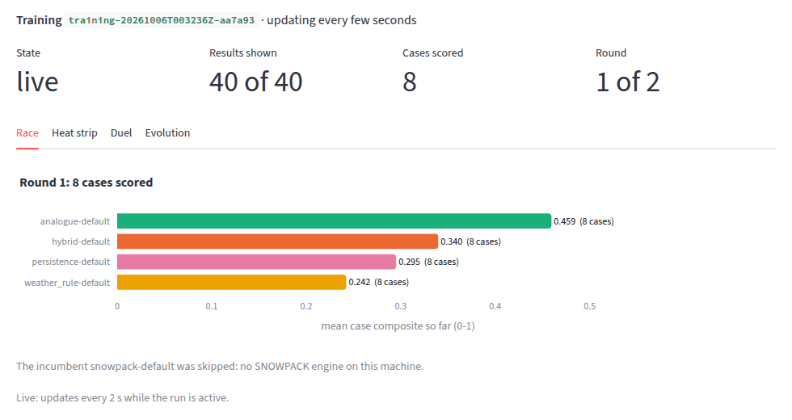

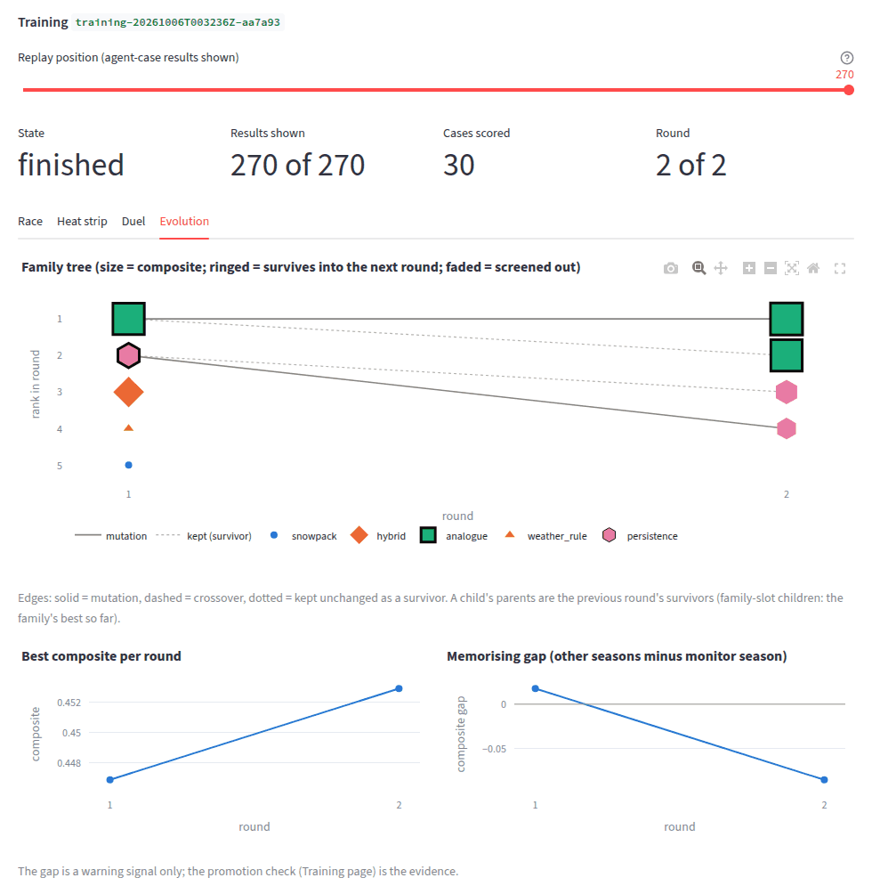

## 6. Reading the results

**Leaderboard.** One row per agent. `composite` is the overall score from 0 to 1 (higher is better), made of five
parts with fixed weights: snow depth (how close the middle estimate of the depth is), layer structure, critical
layers (weak layers of concern), uncertainty (whether the stated range is honest and narrow) and robustness (few
failures, no very bad cases). `scored` is the number of cases; `skipped` means the agent could not run (for
example SNOWPACK without its engine). Compare runs only of the same scoring version (shown on the page; an older
run offers **Re-score under the current version**). Simpson has few pits, so its scores are noisy.

**Choosing survivors** (Start a run › Advanced, "Choose survivors by"). "Even across winters and plots", the default
for new runs, takes the composite less half the agent's *unevenness*: how much more it gains over standard SNOWPACK
in some winters and plots than in others. So an agent that is a little better everywhere beats one that is much
better in two winters and worse elsewhere, which is what a forecast for next winter needs. "Highest average" uses
the composite alone, as runs before 6 October 2026 did. The leaderboard's `unevenness` column shows the measure.

**Penalty for drifting from standard settings** (Start a run › Advanced). New runs take 0.002 off the score for every
unit of *drift*: a setting moved across its whole allowed range counts 1, half-way 0.5, and a changed choice 1, added
up over the agent's settings. A change that does not improve the score by more than it costs is not kept, so agents
stay close to standard SNOWPACK unless the pits say otherwise. The first overnight run's winner had drifted 4.5
units (0.009 off a 0.038 lead). The leaderboard's `drift` column shows it; 0 turns the penalty off, and runs started
before 6 October 2026 have none.

**Stop when the locked-winter score is flat for (rounds)** (Start a run › Advanced). New runs stop on their own once the
best score on the locked test winters has not improved for this many rounds in a row (default 8), and finish
normally with the rounds done: the winner is the last round's best, and the run's report says it stopped early. The
50-round run gained nearly everything by round 8, so a long run no longer spends a day for nothing. 0 turns it off;
it needs locked test winters, and runs started before 9 October 2026 resume without it.

**Agent card** (Run results page). Pick an agent: the table lists each setting that differs from its family's default,
with the change (×1.12 for a multiplier, +0.4°C for a temperature, OLD → NEW for a choice) and what the setting
does, and the ancestry shows each step (mutation or crossover, and which genes changed) back to the starting agents.

**Starting from earlier agents** (Start a run › Advanced). "Start from an earlier run's
agents" adds the best evolved agents of that run (How many: 2 by default) to the five standard starting agents, so
a new run builds on earlier work instead of starting from scratch. The catch: if those agents learned from the
winters the new run locks (any run from before 6 October 2026 did), the new run's locked-winter result is no longer
a clean test, and the page and the report say so. Leave it at "(none)" when you want a fair test.

**Names.** Every evolved agent has a name borrowed from The Wire, The Sopranos, Curb Your Enthusiasm and The
Crown (for example "Omar Balmoral"). The name always belongs to the same settings, so it is the same in the
leaderboard, the agent card, the reports and on the site; the lab's own label (such as `r20-m05-snowpack`) is shown
beside it.

**Put on the public site** (Blind test and site page, part 3). **Send <name> to the site** adds the agent chosen
at the top of that page to https://banff-snowpack.netlify.app as an extra choice under **Weather input**, marked
experimental and not validated; standard SNOWPACK stays the default. The next daily update runs it for this winter
at all three plots, so it appears the following day. Up to three agents at a time; **Remove** takes one off at the
next update. Only SNOWPACK-family agents can be sent. It uses this Mac's GitHub sign-in (once, see Troubleshooting).

**Blind test on this winter** (Blind test and site page, part 2, "Lake Louise, Yoho and Kootenay: the live blind
test"). **Freeze <name> for the blind test** locks the agent chosen at the top of that page in for the winter in
progress, before its pits are dug. Because a freeze cannot be undone, the button works only after you tick the box
above it ("I want to freeze <name>. I know a freeze is permanent..."). It is then scored only on pits dug
after that moment, against standard SNOWPACK: the one test nothing can leak into. A freeze is permanent (recorded on
GitHub with the code version) and a winter takes at most five agents, so freeze the ones you believe in, such as the
best agent on the locked test winters. It uses the same GitHub sign-in as Send to site. The daily update does the
scoring: each frozen agent's line shows how many pit cases it has been scored on so far and its score against
standard SNOWPACK's on the same cases (updated once a day; nothing shows until the first pits after the freeze).
Below it, **Freeze a standard model instead** opens a box where **Or a standard model** picks one of standard
SNOWPACK's variants (such as "SNOWPACK with sensors and new-snow check") and **Freeze <model> for the blind test**
freezes it the same way, after the same tick. This is the clean test for a
change found by looking at the lab's own pits. Only freeze a model whose change acts on this winter: "SNOWPACK with
sensors, new-snow check and snowfall fix" changes older winters' snowfall (before 2015-16), so this winter it
forecasts almost exactly as "SNOWPACK with sensors and new-snow check" does and would waste a place.

**Training reports** (Evolutions › Training reports). Pick a training run: the list shows each run by its start time,
evolution, rounds done, state and best agent, newest first, and opens on the most useful one (promotion checks are not listed).
The report appears at once. It explains in plain words how good the agent is compared with standard SNOWPACK,
whether it may just be memorising past winters, what it changed, how long the run and its last round took (and so
how many rounds fit in a night), and what to do next. **Download (HTML)** gives one file that opens in any browser
or in Word; use Print to save it as a PDF. To report on an earlier round or another agent, or to add the full
numbers, open **Report on another round or agent, or add the technical tables**. A copy of each report is kept in
`data/lab/outputs/reports/`.

**Stability check** (Competitions and checks › Stability check). Most pits record a stability test (mostly
compression tests) and the height where the column broke. The check runs SNOWPACK again for every such pit on the
open winters (the locked test winters stay out) and asks of each stability number: does the layer it calls weakest
sit within 10 cm of a layer that broke, more often than a pick at a random depth would? The numbers are SK38 (the
skier stability index), the critical crack length, RTA (a count of weak-layer signs SNOWPACK works out) and the
lemons count of the model's own layers. Open **Run a new stability check**, choose the agents (standard SNOWPACK
and, by default, the top agent of the newest training run), set the workers and press **Start the stability
check**. Each agent takes about as long as a round of a SNOWPACK training run. The answers show one card per number:
the hit rate, chance, and whether it is better than chance; **The full report** has the tables by plot and for the
layers that broke easily and suddenly. It changes no score and no agent (ADR-127).

Models without SNOWPACK (Carver Daniels, the site's main model, and the lab's column, process switches and other
own models) are checked too, on the layers of their own forecast (ADR-144). They have none of SNOWPACK's numbers,
so they are scored on the **four-sign count**: persistent grains, soft snow, a big hardness jump to a neighbour and a
top between 18 and 94 cm deep. SNOWPACK agents get the same count, and the answers open with one table of it for
every agent, the like-for-like comparison. Carver Daniels is the default choice and takes a few minutes. A check
finished before this count shows **Re-score this check**, which adds it without running SNOWPACK again.

**Group check** (Competitions and checks › Group check). The group check pools a varied group of agents into one answer per pit, on
the locked test winters of a training run you choose (so none of them trained on those winters). The page opens on
the newest check's answers, four cards: is the group better than standard SNOWPACK; does the agents' disagreement
warn of errors; are weak layers most agents agree on really in the pits; and how many of the pits' weak layers no
agent forecast. Below them is what it means for forecasters, the downloads, and **Read the full report here**. With
more than one check, pick one in **Group check**. To run one, open **Run a new group check**: choose the run whose
test winters to use and the agents (the suggested group is standard SNOWPACK, the hybrid agent, the top two agents
of every training run that never saw those winters, and standard SNOWPACK with nudged weather: 15% more or less
snowfall, air 1 degree warmer or colder; agents that trained on the test winters are not offered), then press
**Start the group check**. It runs in the background; its log on this page updates itself every 5 seconds, and the
answers replace it when it is done (the first one took 5 minutes, reusing saved predictions). Start it after a
training run ends (or with 2 workers), since both use the same computer. Terminal:
`snowagent lab group-check --test-run <run> --workers 8`.

**Promotion.** A promotion check ends in PASS or FAIL, by a fixed rule shown on the page: the trained agent must
beat SNOWPACK pooled over all held-out seasons and must not lose in most seasons. Even a PASS changes nothing by
itself: **promotion is never automatic**. A passing agent is a candidate; whether anything it produces ever
reaches the site's output is your decision as the owner (ADR-058), and the site keeps SNOWPACK until then. A FAIL
means the agent stays a research entry. A check with fewer rounds or seasons than the run is weaker and says so.

## 7. Stopping and resuming

Everything you start from the browser runs as its own process. Closing the browser tab, closing the browser, or
stopping the app with Ctrl-C does **not** stop it. Restarting the app shows it again with its live state.

- **Stop**: the Stop button on the job's panel or on the **Jobs** page (for a training: **Stop the run** on Watch
  the run or Start a run). A training stops at its next case (within seconds to a minute); other jobs stop at once.
- **Resume**: after a Stop, a failure or an interruption (the Mac slept or restarted), press **Resume** on the
  job's panel or on the **Jobs** page (for a training: **Resume the run** on Watch the run, or **Resume check** for
  a promotion check). Finished work is kept: a training continues at its first unfinished round, a
  competition at its first unfinished case, a check at its first unfinished season, the set-up at its first missing
  ERA5 month.
- "was cut short" means the process ended without finishing (sleep, restart, power). Resume it.
- **Update and restart** restarts only the app. Jobs are separate from it and keep going; that button is greyed
  out anyway while one runs.

The **Jobs** page lists every job in plain words (what it was, its state, when it started and ended, how long it
took). Choose one to see its steps and its log; the commands it ran are folded underneath.

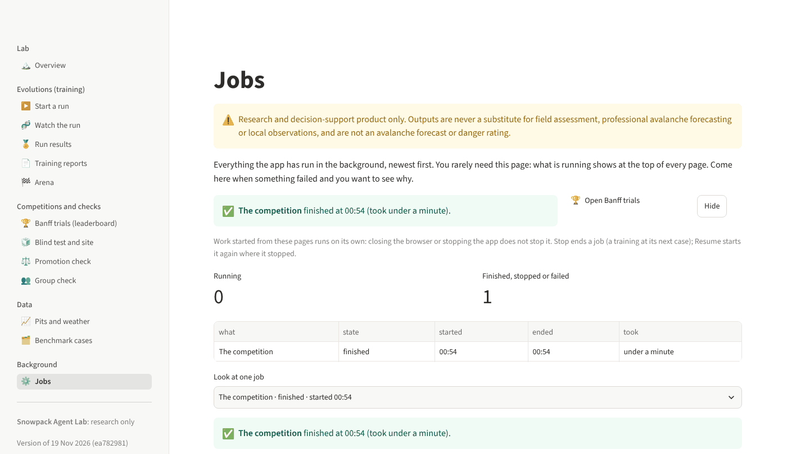

## 8. Keeping the Mac awake overnight

A Mac that sleeps pauses everything; a long job then shows as interrupted and has to be resumed. For an overnight
run:

- Plug the Mac into power.
- Keep the lid open (closing it sleeps a laptop even with the tricks below).
- Start the app so that the Mac stays awake while it runs:

  ```bash
  caffeinate -i snowagent lab app
  ```

  `caffeinate -i` stops the Mac from going to sleep while the app runs (the screen may still turn off; that is
  fine). Leave that Terminal window open. Alternatively, in another Terminal window, `caffeinate -i` alone keeps
  it awake until you press Ctrl-C there.
- In System Settings, you can also turn on the option that prevents automatic sleeping on power adapter when the
  display is off (its name and place vary with the macOS version: Battery > Options, or Energy).

## 9. Where results are stored

Everything the lab makes is in the `data/lab` folder of the project (or the `--data-root` you chose):

| Folder | Contents |
|---|---|
| `data/lab/processed/` | The imported profiles and weather tables |
| `data/lab/benchmark/` | The cases |
| `data/lab/outputs/competitions/<run>/` | One competition: plan, scores, leaderboard, one file per case, the Arena feed `events.jsonl` |
| `data/lab/outputs/training/<run>/` | One training run: rounds, log, summary, the Arena feed |
| `data/lab/outputs/loso_checks/<check>/` | Promotion checks and their results |
| `data/lab/outputs/jobs/<job>/` | Each browser job's commands, state and log |
| `data/lab/outputs/cache/` | Saved predictions, so reruns and resumes are fast (a few GB after a full check) |

All of it can be rebuilt from the project's own files (it only costs time). Never delete `archive/`, `profiles/`,
`observations/`, `data/raw/` or `data/interim/`: those are the inputs.

## 10. Viewing from another device

To look at the app from a phone, tablet or another computer on your home network:

```bash
snowagent lab app --host 0.0.0.0
```

Then find your Mac's address (System Settings > Wi-Fi > Details, or in Terminal `ipconfig getifaddr en0`) and open
`http://<that address>:8501` on the other device, for example `http://192.168.1.23:8501`. If macOS asks whether
Python may accept incoming connections, allow it.

**Caution: the app has no login.** With `--host 0.0.0.0` anyone on the same network can open it and start or stop
jobs. Use it only on your own home network, never on public Wi-Fi; without `--host`, only your Mac can open it.

## 11. Troubleshooting

- **Send to the site says the sign-in or authentication failed**: sign in to GitHub once in Terminal:
  `brew install gh`, then `gh auth login` (choose GitHub.com, HTTPS, "Login with a web browser"), then
  `gh auth setup-git`. Press the button again; the app does not need restarting.
- **`zsh: command not found: brew`**: Homebrew is not installed or not on your PATH: follow
  [`run_locally.md` section 0](run_locally.md#0-one-time-tools-about-10-minutes-mostly-downloads), or open a new
  Terminal window, or run `eval "$(/opt/homebrew/bin/brew shellenv)"`.
- **`snowagent: command not found`**: run `source .venv/bin/activate` in the project folder first.
- **The browser says it cannot connect**: the app is not running (the Terminal window was closed or Ctrl-C was
  pressed). Start it again with `snowagent lab app`; running jobs were not affected.
- **After Update and restart the page says "Connection error" for more than a minute**: the app did not come
  back. Look at the Terminal window that runs it, then start it again with `snowagent lab app` (press Ctrl-C first
  if it is still running). The update itself is already done, and running jobs were not affected.
- **Update and restart is greyed out**: something is running. It works when that has ended, or after you stop it.
- **The notice says this copy has changes of its own**: the app does not update such a copy by itself. Update it
  from Terminal (`git pull`), then press **Restart the app**.
- **The menu shows "Home, Overview, Data Explorer..." for a moment after a restart**: that is Streamlit's own
  list of pages, drawn before the app's menu loads. It goes away by itself within a second.
- **`Port 8501 is already in use`**: another app is running; stop it, or use `snowagent lab app --port 8502` and
  open http://localhost:8502.
- **A page says "No lab data yet"**: press **Run set-up** under **Set up data** on the Overview page.
- **A job failed**: the red line at the top of every page has a link to the **Jobs** page; the end of the log
  there says why. Fix the cause, then press **Resume**. The usual causes: no internet during set-up (resume later),
  `SNOWPACK binary not found` (press **Build the SNOWPACK engine** on the Overview, or use Engine `none` for a
  quick try), a full disk.
- **A job "was cut short"**: the Mac slept or restarted. Press **Resume**.
- **"a ... job is already running"**: one job of each kind runs at a time. Wait, or stop the running one on the
  **Jobs** page.
- **2. Start the check is greyed out**: press **1. Estimate the time** first and wait for the estimate to appear;
  any change of the options needs a new estimate.
- **The training I started is not shown**: it takes about a minute to load its cases; then it shows at the top of
  every page and **Watch the run** opens on it. An older run on that page says "This run is over" and when it
  ended.
- **The Arena does not show a run that just started**: reload the page (the browser's reload button); live runs are
  listed first.
- **Scores look different from the published ones**: check the scoring version on the page, and that the set-up
  fetched the ERA5 months.
- **Anything else**: `run_locally.md` and `local_setup.md` (Troubleshooting), or send the end of the job's log.
